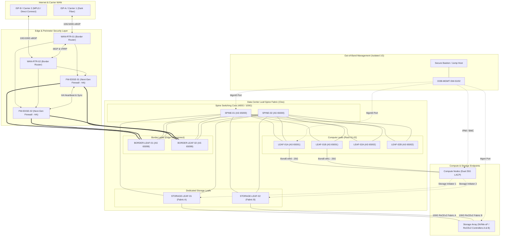
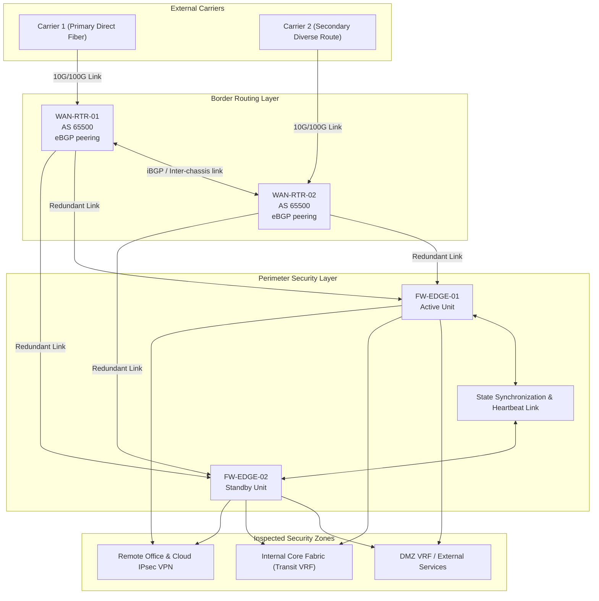
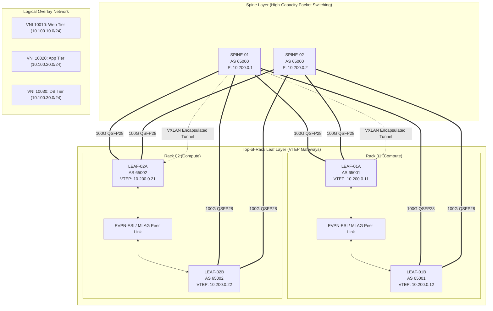
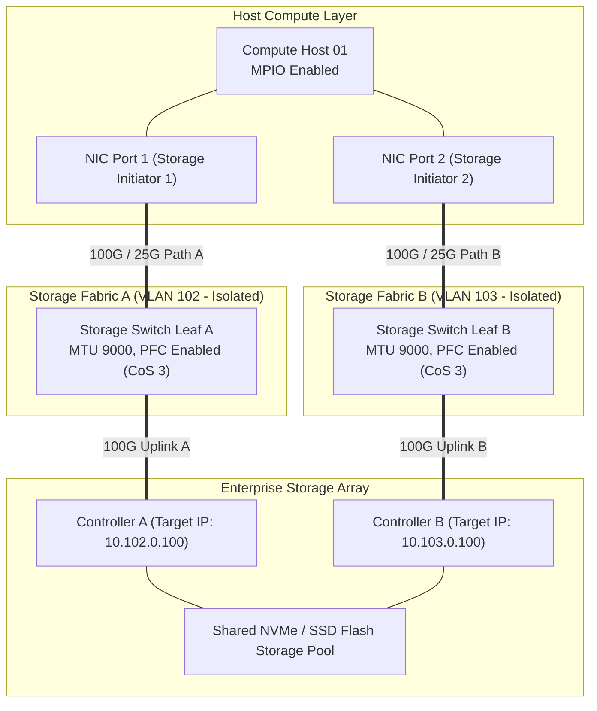
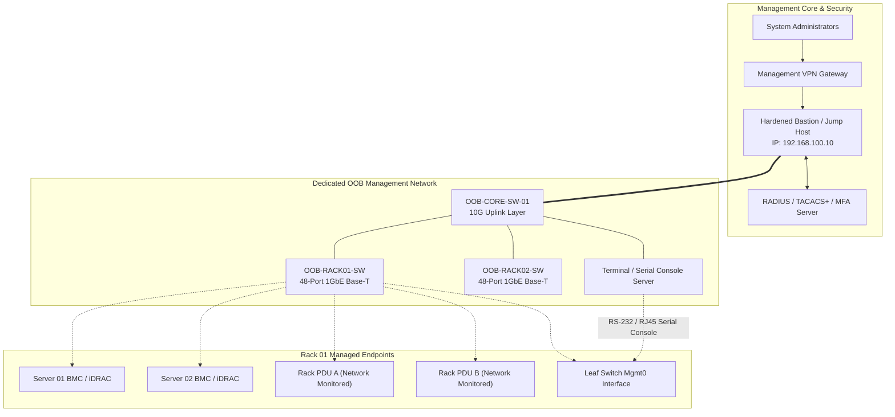

# Datacenter Network Topology & Infrastructure Design Document

## Document Information
- **Project:** Datacenter Infrastructure Architecture
- **Version:** 1.0.0
- **Status:** Approved / Architecture Baseline
- **Target Environment:** Enterprise Production Datacenter (Tier III / N+1 & 2N Redundancy)

---

## Table of Contents
1. [Executive Summary & Scope](#1-executive-summary--scope)
2. [Requirements & Design Objectives](#2-requirements--design-objectives)
   - [2.1 Facility, Availability & Resilience Requirements](#21-facility-availability--resilience-requirements)
   - [2.2 Throughput, Port Density & Capacity Planning](#22-throughput-port-density--capacity-planning)
   - [2.3 Security Zoning, Compliance & Traffic Boundaries](#23-security-zoning-compliance--traffic-boundaries)
3. [Architecture & Component Specification](#3-architecture--component-specification)
   - [3.1 WAN & Perimeter Edge Architecture](#31-wan--perimeter-edge-architecture)
   - [3.2 LAN Data Center Fabric Architecture (Spine-Leaf Clos with VXLAN-EVPN)](#32-lan-data-center-fabric-architecture-spine-leaf-clos-with-vxlan-evpn)
   - [3.3 Server & Compute Connectivity](#33-server--compute-connectivity)
   - [3.4 Storage Networking Architecture](#34-storage-networking-architecture)
   - [3.5 Dedicated Out-of-Band (OOB) Management Network](#35-dedicated-out-of-band-oob-management-network)
   - [3.6 IP Addressing, ASN Allocation & Routing Scheme](#36-ip-addressing-asn-allocation--routing-scheme)
4. [Topology Diagrams](#4-topology-diagrams)
   - [4.1 End-to-End Comprehensive Datacenter Topology](#41-end-to-end-comprehensive-datacenter-topology)
   - [4.2 WAN & Edge Security Perimeter Diagram](#42-wan--edge-security-perimeter-diagram)
   - [4.3 LAN Spine-Leaf Fabric with VXLAN-EVPN Overlay Diagram](#43-lan-spine-leaf-fabric-with-vxlan-evpn-overlay-diagram)
   - [4.4 Server & Compute Dual-Homing Topology](#44-server--compute-dual-homing-topology)
   - [4.5 Storage Fabric Architecture (RoCEv2 / NVMe-oF / iSCSI & MPIO)](#45-storage-fabric-architecture-rocev2--nvme-of--iscsi--mpio)
   - [4.6 Out-of-Band (OOB) Management Network Diagram](#46-out-of-band-oob-management-network-diagram)
5. [Tooling, Conventions & Documentation Standards](#5-tooling-conventions--documentation-standards)
   - [5.1 Diagramming Tools & Stencil Standards](#51-diagramming-tools--stencil-standards)
   - [5.2 Hostname & Device Naming Conventions](#52-hostname--device-naming-conventions)
   - [5.3 Structured Cabling & Labeling Standard (ANSI/TIA-606-C)](#53-structured-cabling--labeling-standard-ansitia-606-c)
6. [Failure Domain & SPOF Analysis](#6-failure-domain--spof-analysis)
7. [Cross-Functional Review & Sign-Off Checklist](#7-cross-functional-review--sign-off-checklist)

---

## 1. Executive Summary & Scope

This document defines the architectural blueprint, physical topology, and logical designs for the enterprise datacenter network infrastructure. 

The primary purpose is to deliver a non-blocking, highly available, deterministic, and secure network infrastructure capable of scaling linearly to support mission-critical enterprise compute, converged storage platforms (NVMe-oF/RoCEv2 and iSCSI), edge hybrid-cloud interconnects, and strict multi-tenant segmentation.

### Design Principles:
1. **High Availability with No Single Point of Failure (SPOF):** Dual-homed links, dual power supplies (A+B power feeds), active-active multi-chassis link aggregation (MLAG / EVPN-ESI), and resilient routing failover.
2. **Deterministic Latency & Non-Blocking Bandwidth:** Leaf-Spine (Clos) topology providing predictable east-west traffic latency with configurable oversubscription ratios (≤ 3:1 for compute, 1:1 for storage).
3. **Open Standards & Interoperability:** Layer 3 underlay utilizing BGP (RFC 7938) and an overlay utilizing VXLAN with BGP EVPN (RFC 8365 / RFC 7432).
4. **Zero-Trust Security & Segmentation:** Micro-segmentation with tenant VRFs, stateful perimeter security inspection, hardware-enforced ACLs, and isolated Out-of-Band (OOB) management.

---

## 2. Requirements & Design Objectives

### 2.1 Facility, Availability & Resilience Requirements
- **Tier Standard:** Tier III compliant facility design (concurrently maintainable, 99.982% uptime target).
- **Power Redundancy:** 2N (A/B) uninterruptible power supply (UPS) feeds to every rack; all active devices must feature dual hot-swappable power supply units (PSUs).
- **Rack Footprint:** Standard 19-inch 42U/48U server enclosures with dedicated hot/cold aisle containment.
- **Cooling:** N+1 in-row / perimeter CRAC/CRAH precision cooling units.

### 2.2 Throughput, Port Density & Capacity Planning
- **Compute Downlinks:** Dual 25GbE SFP28 per standard compute node; 100GbE QSFP28 per high-density AI/HPC GPU node.
- **Storage Network:** Dedicated 100GbE QSFP28 interfaces per storage controller supporting RDMA over Converged Ethernet (RoCEv2) or Fibre Channel over Ethernet (FCoE) / iSCSI.
- **Fabric Uplinks:** 100GbE QSFP28 / 400GbE QSFP-DD uplinks from Leaf to Spine switches, with a maximum 3:1 oversubscription ratio for general compute and 1:1 (line-rate) non-blocking for storage.
- **Edge & WAN Circuits:** Dual redundant 10GbE / 100GbE carrier connections from diverse physical entry points (Meet-Me-Rooms: MMR-A and MMR-B).

### 2.3 Security Zoning, Compliance & Traffic Boundaries
The infrastructure enforces five distinct security and routing zones:
1. **Perimeter / DMZ Zone:** External-facing web proxies, ingress controllers, VPN endpoints, and public API gateways.
2. **Enterprise Compute Zone (Internal LAN):** Application microservices, container workloads (Kubernetes worker pools), and database clusters.
3. **Storage Zone:** Dedicated, isolated network partition (Layer 2 non-routable or isolated VRF) with jumbo frames (MTU 9000/9216) and priority-based flow control (PFC).
4. **WAN / Inter-DC Zone:** High-speed interconnects (Dark Fiber, MPLS, Carrier Direct Connect) to secondary datacenters and public cloud VPCs.
5. **Out-of-Band (OOB) Management Zone:** Dedicated physical switches, zero data plane transit, isolated IPMI/BMC, console serial servers, and switch management ports.

---

## 3. Architecture & Component Specification

### 3.1 WAN & Perimeter Edge Architecture
- **Border Routers (WAN-RTR-01, WAN-RTR-02):** Dual carrier-grade edge routers deployed in diverse cages/racks connected to Tier-1 ISPs via eBGP (Border Gateway Protocol).
- **Carrier Diversity:** Two separate telecom providers entering via independent building entrance facilities (BEF) and MMRs to eliminate fiber cut vulnerabilities.
- **Edge Security Cluster (FW-EDGE-01, FW-EDGE-02):** Next-Generation Firewalls (NGFW) deployed in Active/Standby or Active/Active clustering with state synchronization, SSL/TLS inspection, IDS/IPS, and hardware crypto acceleration for IPsec/WireGuard VPN tunnels.
- **DDoS Mitigation & Border BGP Peering:** BGP Flowspec and upstream BGP blackhole communities for automated volumetric DDoS mitigation.

### 3.2 LAN Data Center Fabric Architecture (Spine-Leaf Clos with VXLAN-EVPN)
- **Physical Fabric (Underlay):**
  - **Spines (SPINE-01 through SPINE-04):** High-throughput, non-blocking 100G/400G packet switches. Spines only connect to Leafs (no direct host, storage, or spine-to-spine connections).
  - **Leafs (LEAF-01 through LEAF-NN):** Top-of-Rack (ToR) switches providing 25G downlinks to hosts and 100G uplinks to all spines.
  - **Underlay Routing:** Point-to-point `/31` IPv4 subnets between each Leaf and Spine interface. Underlay BGP peering (eBGP per leaf or OSPF/IS-IS) distributes loopback addresses with ECMP (Equal-Cost Multi-Path) enabled across all spines.
  - **MTU Configuration:** Underlay MTU set to 9216 bytes (Jumbo frames) to support VXLAN encapsulation overhead (50 bytes) without IP fragmentation.
- **Logical Overlay (Overlay):**
  - **BGP EVPN Control Plane:** Multi-Protocol BGP (MP-BGP) EVPN routes (Type-2 MAC/IP, Type-3 Inclusive Multicast, Type-5 IP Prefix).
  - **Distributed Anycast Gateway:** Leaf switches act as default gateways for local subnets with identical virtual IP and virtual MAC addresses, enabling seamless workload mobility without hair-pinning traffic to a centralized core.
  - **Multi-Tenancy:** Virtual Routing and Forwarding (VRF) instances mapped to Virtual Network Identifiers (VNIs) provide hardware-isolated tenant segmentation.

### 3.3 Server & Compute Connectivity
- **Dual-Homed Top-of-Rack (ToR):** Each rack contains an active-active pair of Leaf switches (e.g., LEAF-A and LEAF-B) utilizing EVPN Ethernet Segment Identifier (ESI-LAG) or Multi-Chassis Link Aggregation (MLAG).
- **Server NIC Bonding:**
  - Standard Compute: 2x 25GbE interfaces bonded using LACP (IEEE 802.3ad, mode 4) with `xmit_hash_policy=layer3+4`.
  - Host Virtualization (KVM/ESXi): Virtual distributed switches (vDS) or Open vSwitch (OVS) with uplink load balancing.
- **VLAN to VNI Mapping:** Server access VLANs are terminated at the leaf switch and encapsulated into corresponding VXLAN VNIs.

### 3.4 Storage Networking Architecture
- **Protocol Options:**
  - **RoCEv2 (RDMA over Converged Ethernet):** Ultra-low latency NVMe-oF transport over Ethernet fabric. Requires DCB (Data Center Bridging): Priority-based Flow Control (PFC, 802.1Qbb) on CoS 3 and Explicit Congestion Notification (ECN, RFC 3168) with WRED.
  - **iSCSI / NFS / Ceph:** Redundant dedicated storage VLANs configured with MTU 9000.
  - **Fibre Channel (Optional SAN Fabric):** Dual air-gapped SAN fabrics (Fabric A / Fabric B) using dedicated 32G/64G FC switches.
- **Multipath I/O (MPIO):**
  - Storage arrays feature active/active dual controllers (Controller A & Controller B).
  - Compute hosts configure MPIO with round-robin or least-queue-depth path selection across independent subnets/fabrics to ensure seamless path failover.

### 3.5 Dedicated Out-of-Band (OOB) Management Network
- **Complete Isolation:** Dedicated physical 1GbE/10GbE switching infrastructure completely air-gapped from production data plane traffic.
- **Connected Components:**
  - Server Baseboard Management Controllers (BMC): Dell iDRAC, HPE iLO, Supermicro IPMI.
  - Network Switch Management Interfaces (eth0 / mgmt0).
  - Serial Terminal / Console Servers (Opengear, Avocent) for zero-network serial console access.
  - Smart Rack Power Distribution Units (ePDUs) and Environmental Monitoring Sensors.
- **Access Control:** Restricted access via jump hosts / bastion servers with multi-factor authentication (MFA) and dedicated management firewall rules.

### 3.6 IP Addressing, ASN Allocation & Routing Scheme

#### ASN Allocation Scheme (eBGP Underlay RFC 7938)
| Device Role | ASN Type | ASN Range / Value | Description |
|---|---|---|---|
| Spines | 2-byte / 4-byte Private ASN | ASN 65000 | Common ASN across all Spines |
| Leaf Pair Rack 01 | Private ASN | ASN 65001 | Distinct ASN per Leaf pair |
| Leaf Pair Rack 02 | Private ASN | ASN 65002 | Distinct ASN per Leaf pair |
| Border Leaf Pair | Private ASN | ASN 65099 | Border Leafs connecting to Edge WAN |
| Edge WAN Routers | Public or Dedicated Private | ASN 65500 | Border edge routing layer |

#### IPv4 Subnet Allocation Strategy
| Allocation Block | Subnet Mask | Function | Description |
|---|---|---|---|
| `10.200.0.0/22` | `/32` per device | Fabric Loopbacks (VTEPs) | Leaf and Spine Loopback0 addresses |
| `10.200.4.0/22` | `/31` point-to-point | Fabric Underlay P2P Links | Inter-switch Leaf-to-Spine links |
| `10.100.0.0/16` | Various (`/24`, `/26`) | Enterprise Compute VRF | Production web, application, databases |
| `10.101.0.0/16` | `/24` per subnet | DMZ / Perimeter VRF | External ingress and DMZ services |
| `10.102.0.0/16` | `/24` non-routed | Storage Fabric A | Storage Controller A & Host Initiator 1 |
| `10.103.0.0/16` | `/24` non-routed | Storage Fabric B | Storage Controller B & Host Initiator 2 |
| `192.168.100.0/22` | `/24` per zone | OOB Management Network | IPMI, switch mgmt, serial console, PDUs |

---

## 4. Topology Diagrams

### 4.1 End-to-End Comprehensive Datacenter Topology


---

### 4.2 WAN & Edge Security Perimeter Diagram


---

### 4.3 LAN Spine-Leaf Fabric with VXLAN-EVPN Overlay Diagram


---

### 4.4 Server & Compute Dual-Homing Topology
```
           +---------------------------------------------+
           |                SPINE SWITCHES               |
           +----------------------+----------------------+
                                  |
            100GbE Uplinks        |        100GbE Uplinks
         +------------------------+------------------------+
         |                                                 |
         v                                                 v
+------------------+                             +------------------+
|     LEAF-01A     | <===== MLAG / EVPN-ESI =====> |     LEAF-01B     |
|   (ToR Switch 1) |           Peer Link         |   (ToR Switch 2) |
+--------+---------+                             +---------+--------+
         | Port 1                                          | Port 1
         | 25GbE DAC                                       | 25GbE DAC
         | (LACP Member 1)                                 | (LACP Member 2)
         +-----------------------+ +-----------------------+
                                 | |
                                 v v
                      +-----------------------+
                      |     COMPUTE SERVER    |
                      |  Bond0 (802.3ad LACP) |
                      |    IP: 10.100.10.50   |
                      |  Dual-Port 25GbE NIC  |
                      |    [eth0]   [eth1]    |
                      +-----------+-----------+
                                  |
                                  | Dedicated 1GbE
                                  v
                      +-----------------------+
                      |   iDRAC / IPMI BMC    |
                      |    IP: 192.168.100.50 |
                      +-----------+-----------+
                                  |
                                  v
                      +-----------------------+
                      |    OOB MGMT SWITCH    |
                      +-----------------------+
```

---

### 4.5 Storage Fabric Architecture (RoCEv2 / NVMe-oF / iSCSI & MPIO)


---

### 4.6 Out-of-Band (OOB) Management Network Diagram


---

## 5. Tooling, Conventions & Documentation Standards

### 5.1 Diagramming Tools & Stencil Standards
- **Preferred Diagram Formats:**
  - **Mermaid.js:** Maintained directly inside markdown documentation in git for version-controlled, executable diagramming.
  - **Draw.io / diagrams.net (`.drawio`):** For publication-quality physical rack elevation and detailed visual network layouts. Stored in vector XML formats.
  - **Lucidchart / Microsoft Visio (`.vsdx`):** Standard enterprise repository format using official vendor stencils.
- **Color Coding Conventions:**
  - **Edge / WAN:** Yellow / Orange
  - **Core & Spine Fabric:** Dark Blue
  - **Compute Leaf Layer:** Teal / Cyan
  - **Storage Fabric:** Purple / Magenta
  - **Out-of-Band Management:** Green
  - **Power Feeds (A/B):** Red (Feed A), Blue (Feed B)

### 5.2 Hostname & Device Naming Conventions
All infrastructure assets must follow a structured, deterministic naming syntax:

```
<Site/DC>-<Room/Pod>-<DeviceRole>-<RackID>-<UnitID>
```

#### Syntax Reference:
- **Site/DC:** `DC1` (Primary Data Center), `DC2` (Disaster Recovery Center)
- **Room/Pod:** `R01` (Data Hall 1), `P01` (Pod 1)
- **Device Role Code:**
  - `RTR`: WAN Edge / Core Border Router
  - `FW`: Firewall / Security Appliance
  - `SPN`: Fabric Spine Switch
  - `LEF`: Fabric Leaf / ToR Switch
  - `SLF`: Dedicated Storage Leaf Switch
  - `OOB`: Out-of-Band Management Switch
  - `CSL`: Serial Console Server
  - `SRV`: Compute / Bare Metal Server
  - `SAN`: Storage Array Controller
  - `PDU`: Power Distribution Unit
- **Rack ID:** `RK01` through `RK99`
- **Unit ID:** `U01` through `U48` (Top-of-chassis rack unit location)

*Examples:*
- `DC1-R01-SPN-RK05-U40`: DC1, Room 1, Spine switch, Rack 5, Unit 40.
- `DC1-R01-LEF-RK02-U47`: DC1, Room 1, Leaf switch A, Rack 2, Unit 47.
- `DC1-R01-SRV-RK02-U12`: DC1, Room 1, Compute server, Rack 2, Unit 12.

### 5.3 Structured Cabling & Labeling Standard (ANSI/TIA-606-C)
- **Cable Types & Media:**
  - **Intra-Rack Server Downlinks:** 25GbE Passive Direct Attach Copper (DAC) SFP28 cables (≤ 3m) to minimize cost, power consumption, and latency.
  - **Inter-Rack Leaf-to-Spine Uplinks:** 100GbE / 400GbE Active Optical Cables (AOC) or MPO/MTP-12 multi-mode OM4 fiber.
  - **Storage Fabric Links:** OM4/OM5 fiber with SR4 transceivers or shielded high-speed copper.
  - **Management Links:** Cat6A UTP (RJ-45) up to 1GbE/10GbE.
- **Cable Labeling Format:** Every cable must be labeled at both ends within 50mm of the connector using wrap-around heat-shrink labels:
  ```
  [Source Device]:[Source Port] ===> [Dest Device]:[Dest Port]
  Example: DC1-LEF-RK01-U48:Eth1/1 ===> DC1-SPN-RK05-U40:Eth1/1
  ```

---

## 6. Failure Domain & SPOF Analysis

| Component | Failure Scenario | Redundancy Mechanism | Impact / Recovery Time |
|---|---|---|---|
| **Carrier WAN Link** | Fiber cut on ISP-A physical path | eBGP automatic failover to ISP-B carrier | Sub-second BFD failover; zero session reset |
| **Edge Firewall** | Hardware failure of FW-EDGE-01 | Active/Standby HA cluster sync | Transparent failover (< 1s); state tables maintained |
| **Spine Switch** | Total loss of SPINE-01 | Fabric ECMP over remaining Spines (SPINE-02..04) | Negligible; bandwidth reduced by 1/N; no traffic loss |
| **Leaf / ToR Switch** | Power or ASIC fault on LEAF-01A | EVPN-ESI / MLAG failover to LEAF-01B | Server bond shifts traffic to slave interface in < 10ms |
| **Server NIC Port** | Transceiver or cable failure | Linux Bond (802.3ad LACP) active-active | Instantaneous failover to secondary port |
| **Storage Controller** | Controller A fault / reboot | Storage MPIO with ALUA failover to Controller B | I/O paused momentarily (~1-3s); no data loss or disconnect |
| **Rack Power Feed** | Loss of Utility Feed A / UPS A | Dual A+B PSUs on all servers and switches | Zero interruption; Feed B carries total load |
| **OOB Mgmt Switch** | OOB switch failure | Production data unaffected; serial console secondary | Maintenance window replacement; no production impact |

---

## 7. Cross-Functional Review & Sign-Off Checklist

- [x] **Network Architecture:**
  - [x] Spine-Leaf Clos fabric oversubscription verified (≤ 3:1).
  - [x] BGP underlay and EVPN overlay route reflector / eBGP designs approved.
  - [x] Jumbo frames (MTU 9000/9216) configured uniformly across all fabric links.
- [x] **Compute & Virtualization:**
  - [x] Server LACP hash policy validated (`layer3+4` for deterministic distribution).
  - [x] Hypervisor virtual distributed switches mapped to correct VLAN/VNI IDs.
- [x] **Storage Engineering:**
  - [x] Lossless Ethernet (PFC 802.1Qbb and ECN) verified for RoCEv2 workloads.
  - [x] Dual-fabric isolation verified for non-routable storage paths.
  - [x] Host MPIO parameters configured for automatic failover.
- [x] **Security & Compliance:**
  - [x] Zone firewalls and DMZ segmentation satisfy compliance requirements.
  - [x] Complete physical isolation of OOB network confirmed.
  - [x] Multi-factor authentication required for console and jump host access.
- [x] **Facilities & Operations:**
  - [x] A+B dual power feeds mapped to distinct circuit breakers.
  - [x] Cable labeling strictly adheres to ANSI/TIA-606-C standards.
